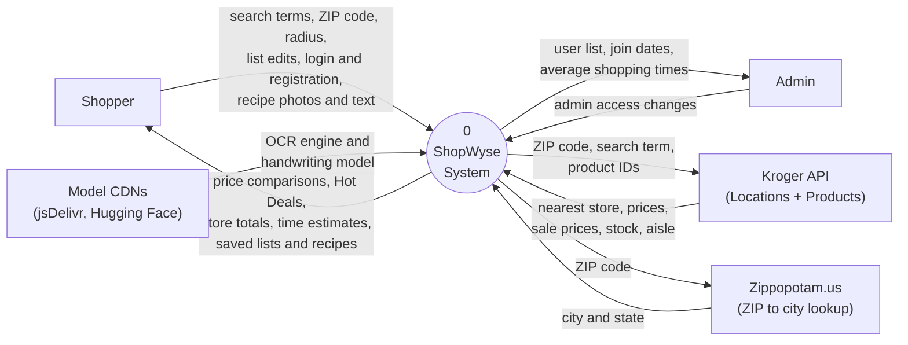
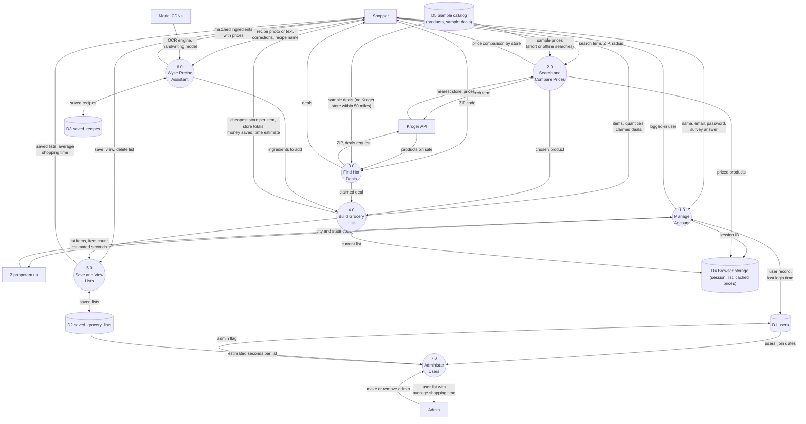

# ShopWyse Grocery App

**Live site:** https://mtchr.github.io/Shopwyse_Grocery_App/

## App Summary

Grocery shopping is an essential but time-consuming task, and shoppers who want the best prices often have to check several stores to find them. Our primary persona, Stephanie Baldwin, is a 45-year-old shopping for a family of seven who is always looking to keep grocery costs down. She often discovers mid-trip that her groceries cost more than planned, and that another store nearby had the same items for less. ShopWyse solves this by letting shoppers search for their groceries ahead of time and compare prices across nearby stores (Walmart, Trader Joe's, Costco, Target, and the nearest Kroger-family store such as Smith's, Fry's, or Ralphs) for any US ZIP code. Users enter a ZIP code and a driving radius, add items to a grocery list, and see which store gives them the lowest total. The app also includes a Hot Deals tab with real sale prices from the nearest Kroger-family store, the Wyse AI recipe assistant, an admin page, and notification preferences. It is designed to be simple and frictionless for a busy, older audience, with big buttons and a minimal login. Users can save their grocery lists, view previously saved lists, start new lists, and track their estimated grocery shopping time.

## ERD

Please see the ERD PDF for full ERD

### userstimes table

`userstimes` records one row per shopping trip, so we can track how long each user spends shopping.

alana - 10 minutes, 3 items 
      - 12 minutes, 6 items
      - 25 minutes, 30 items 

ashlyn - 22 items, avg was 1 minute and 25.71 seconds, stores => Costco, Walmart Supercenter, Dollar Tree

| Column | Type | Notes |
| --- | --- | --- |
| `timeid` | `int8` | Primary key |
| `userid` | `int8` | Foreign key to `users.userid` (one user has many time entries) |
| `minutesspent` | `int8` | Length of the shopping trip in minutes |
| `loggedat` | `timestamptz` | When the trip was logged |

Column names are all lowercase, so unlike the camelCase columns in `users` (`"firstName"`, `"recentZip"`), they don't need double quotes in SQL.

### saved_grocery_lists table

`saved_grocery_lists` stores each user's saved grocery lists, including the items, quantities, save date, and estimated shopping time.

| Column | Type | Notes |
| --- | --- | --- |
| `listid` | `int8` | Primary key |
| `userid` | `int8` | Foreign key to `users.userid` |
| `saved_at` | `timestamptz` | When the list was saved |
| `item_count` | `integer` | Number of items in the list |
| `estimated_seconds` | `numeric` | Estimated shopping time in seconds |
| `items` | `jsonb` | Saved grocery list items and quantities |

### saved_recipes table

`saved_recipes` stores recipes users save from the Wyse AI Assistant. Only the ingredient text is saved; which ShopWyse products match and their prices are worked out each time a recipe is opened, so they stay current.

| Column | Type | Notes |
| --- | --- | --- |
| `recipeid` | `int8` | Primary key |
| `userid` | `int8` | Foreign key to `users.userid` (one user has many recipes) |
| `name` | `text` | Recipe name the user typed |
| `ingredients` | `jsonb` | Array of ingredient lines, e.g. `["3 eggs", "2 cups flour"]`, including ones ShopWyse doesn't sell |
| `created_at` | `timestamptz` | When the recipe was first saved |
| `updated_at` | `timestamptz` | When the recipe was last edited |

## Tech Stack

| Layer | What we used | Why |
| --- | --- | --- |
| Frontend | A single HTML file (`index.html`) with plain JavaScript, styled with Tailwind CSS (CDN), with Font Awesome for icons and Tesseract.js plus a Transformers.js handwriting model for Wyse recipe scanning | No build step or installs. Anyone on the team can open the file in a browser, make a change, and see it immediately, which fits a fast design-sprint prototype. |
| Backend / API | Supabase's auto-generated REST API, called with `supabase-js` (CDN) | Supabase creates an API for every table automatically, so we didn't have to write or host a server. |
| Database | Supabase (hosted PostgreSQL) | A real relational database that matches our ERD, with a web dashboard where the team can view and edit rows without writing SQL. |
| Live prices | Kroger Products and Locations API, called from a Supabase Edge Function (`supabase/functions/kroger-search`) | Gives real prices and sale prices from the nearest Kroger-family store for any ZIP. The function keeps the Kroger client secret off the web page and caches results to stay inside Kroger's daily limits. Walmart, Target, Costco and Trader Joe's have no public API, so their prices are estimates based on the Kroger price. |
| Hosting | GitHub Pages | Serves `index.html` from the `main` branch, so merging to `main` publishes the site. |

This approach fits our team because we are a product design team building a prototype for user interviews, not a production system. Keeping everything in one file with a hosted database means less setup and more time spent testing with users. Because this is a demo, passwords are stored in plain text and Row Level Security is turned off. Use throwaway passwords only.

## Data Flow Diagrams

Rectangles are external entities, circles are processes, and cylinders are data stores. GitHub draws these diagrams from the Mermaid code below.

### Level 0 (Context Diagram)



### Level 1



## How to Get It Running

1. Get a copy of the code:
   ```
   git clone https://github.com/mtchr/Shopwyse_Grocery_App.git
   ```
   Or, on GitHub, click **Code → Download ZIP** and unzip it.
2. Open the project folder and double-click `index.html` to open it in a web browser (Chrome, Edge, Firefox, or Safari). An internet connection is required, because the styling, live prices, and database are loaded online.
3. That's it. The Supabase project URL and publishable key are already in `index.html`, so the app connects to our shared database automatically.

**Using your own Supabase project instead (optional):**

1. Create a project at [supabase.com](https://supabase.com).
2. In the **SQL Editor**, create the users table:
   ```sql
   create table public.users (
     userid bigint generated always as identity primary key,
     created_at timestamptz not null default now(),
     "firstName" text not null,
     "lastName" text not null,
     email text not null,
     password text not null,
     notifications boolean,
     "recentZip" integer
   );
   alter table public.users disable row level security;
   ```
   Then create the `userstimes` table, which logs how long each user spends on a shopping trip:
   ```sql
   create table public.userstimes (
     timeid bigint generated always as identity primary key,
     userid bigint not null references public.users (userid) on delete cascade,
     minutesspent bigint not null,
     loggedat timestamptz not null default now()
   );
   alter table public.userstimes disable row level security;
   ```
   Then create the `saved_grocery_lists` table, which stores each user's saved grocery lists, including the items, quantities, save date, and estimated shopping time:
   ```sql
   create table public.saved_grocery_lists (
    listid bigint generated always as identity primary key,
    userid bigint not null references public.users(userid) on delete cascade,
    saved_at timestamptz not null default now(),
    item_count integer not null,
    estimated_seconds numeric not null,
    items jsonb not null
   );
   alter table public.saved_grocery_lists disable row level security;
   ```
   Then create the `saved_recipes` table, which stores recipes saved from the Wyse AI Assistant:
   ```sql
   create table public.saved_recipes (
     recipeid bigint generated always as identity primary key,
     userid bigint not null references public.users (userid) on delete cascade,
     name text not null,
     ingredients jsonb not null default '[]'::jsonb,
     created_at timestamptz not null default now(),
     updated_at timestamptz not null default now()
   );
   alter table public.saved_recipes disable row level security;
   grant select, insert, update, delete on public.saved_recipes to anon, authenticated;
   ```

3. Go to **Project Settings → API Keys** and copy the **Project URL** and **publishable key**. Never use the secret key in this app, because anyone who opens the page can read it.
4. In `index.html`, replace the values of `SUPABASE_URL` and `SUPABASE_ANON_KEY` near the top of the main `<script>` block, then open the file in a browser.

## Verifying the Vertical Slice

Our vertical slice is account creation and login: the **Complete Registration** button saves a new user to the Supabase `users` table, and the **Log In** button checks entered credentials against that table.

1. Open `index.html` and click **CREATE ACCOUNT** in the green banner on the home screen.
2. Enter a first name, last name, email, and password, then click **Complete Registration**. You should see "Account created successfully!" and your first name in the header.
3. **Refresh the page.** You stay signed in, because the app remembers your session. Click **Account**, then **Log Out**.
4. Click **Account** in the header, then **Log In Now** in the pop-up. Enter the same email and password and click **Log In**. You should see "Successfully logged in!", your first name in the header, and "{First name}'s Grocery List" on the list screen. This proves the account survived the refresh.
5. To confirm it fails correctly, refresh the page again and try logging in with an email that has no account, or with the wrong password. You should see "Incorrect email or password" and stay on the login screen.
6. Optional: in the Supabase dashboard, open **Table Editor → users** to see the new row with the name, email, password, and notification preference you entered.

## Saved Grocery Lists and Shopping Time

### Estimate Shopping Time
- Estimated grocery shopping time uses a pooled average of about 77 seconds per item, from four timed shopping trips (61 items) by the team.
- The estimate automatically updates when items or quantities change.
- Estimated time is displayed in minutes and seconds.
- Driving time is not included in the estimate.

### Save a Grocery List
- Users can click the **Save Grocery List** button to save their current list.
- Each saved list stores its items, quantities, save date, item count, and estimated shopping time.
- After saving, users can start a new grocery list without losing previously saved lists.

### View or Start a Grocery List
- Users can select **See Most Recent Grocery List** to view their latest saved list.
- Users can select **Start New List** to begin a new grocery list.
- Previously saved grocery lists remain available.

### View Shopping Time History
- The Account Profile displays the average estimated shopping time across saved grocery lists.
- Users can view their previous grocery lists, including their save dates and estimated shopping times.

## Saved Recipes (Wyse AI Assistant)

- After Wyse reads a recipe photo or typed ingredients, users can name the recipe and click **Save recipe**. Every line is saved, including fixes the user typed and ingredients ShopWyse doesn't sell.
- The **My recipes** tab in the Wyse AI Assistant lists the user's saved recipes.
- Opening a recipe lets users rename it, edit, remove, or add ingredient lines, then **Save changes**, or **Delete recipe**.
- Each ingredient ShopWyse sells shows its cheapest store and price, with a checkbox. Users uncheck what they already have and click **Add items to grocery list**, which adds 1 of each checked item. Ingredients ShopWyse doesn't sell are marked "Not sold in ShopWyse."
- Saving and viewing recipes requires an account.
